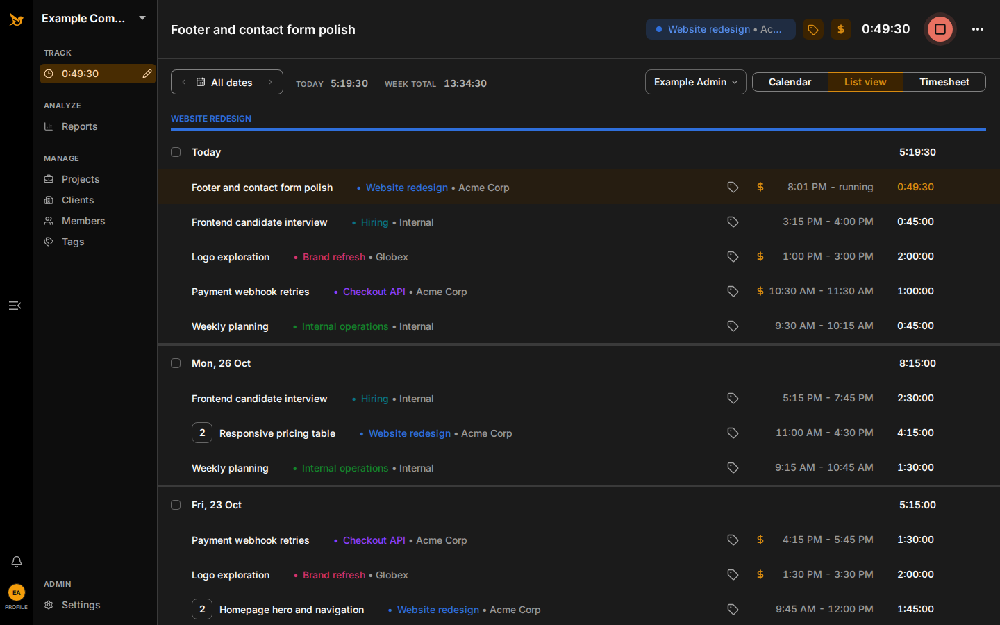
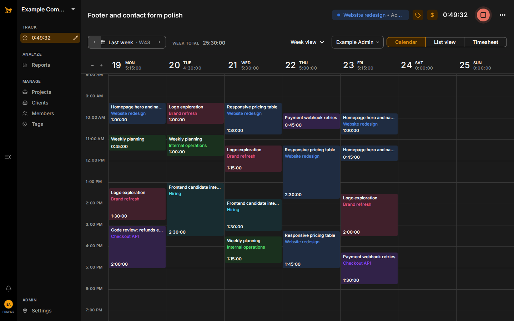
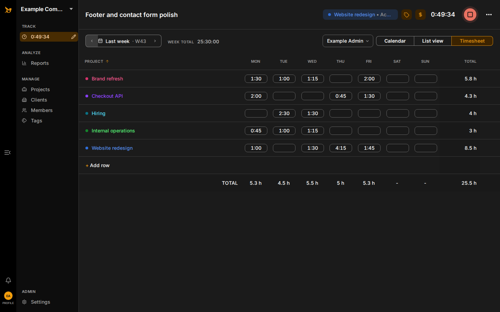
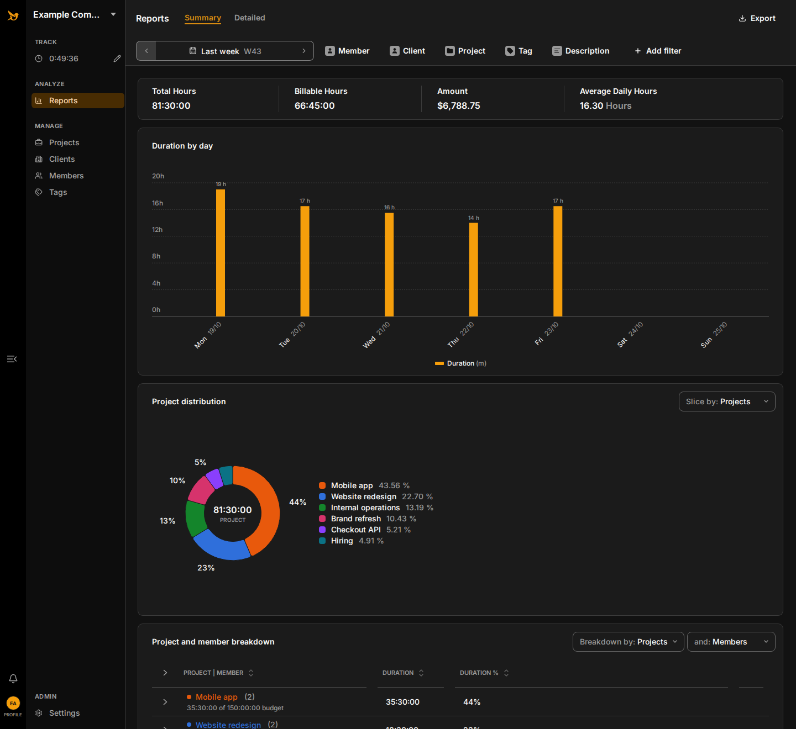
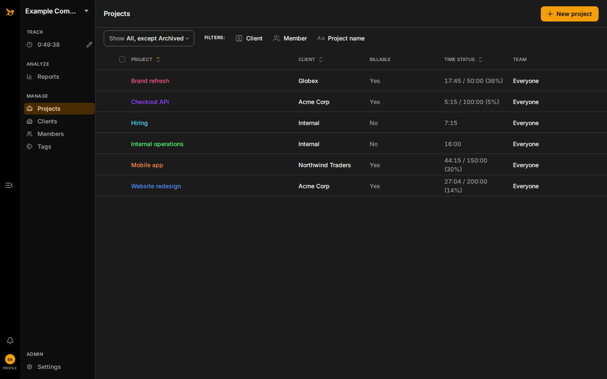

<div align="center">

<picture>
  <source media="(prefers-color-scheme: dark)" srcset="public/brand/hourlark-original/logo-dark.png" />
  
</picture>

### Self-hosted time tracking for your company, on a single Cloudflare Worker

[](https://github.com/Sheikh566/hourlark/actions/workflows/deploy.yml)


[Features](#features) · [Screenshots](#screenshots) · [Quick start](#quick-start) ·
[Deploy](#deploy-to-cloudflare) · [Documentation](#documentation)



</div>

## Overview

Hourlark is a self-hosted alternative to Toggl Track for a single company. One Cloudflare Worker
serves the React application and the same-origin `/api/v1` API, with Cloudflare D1 as the
authoritative database. Sign-in uses Google or Cloudflare Access, and every permission is enforced
on the server.

There are no per-seat fees and no servers to manage: fork the repository, set a few GitHub
variables, and every push to `main` deploys to your own Cloudflare account.

## Features

**Time tracking**

- Authoritative, idempotent start/stop timers with one running timer per member.
- Day and week list editing, plus calendar creation, drag and resize.
- Overlap warnings, duplicate, continue, soft-delete and undo.
- Long-running timer and tracking reminders, in-app and as browser push notifications.

**Reports and exports**

- Summary and detailed reports with timezone-aware clipping, grouping and rounding.
- Billable amounts, financial redaction by role, and project budget progress.
- Formula-safe UTF-8 CSV and a Workers-native, client-ready PDF time report.

**Workspace management**

- Clients, projects, project assignments, tags and members.
- Member, Manager and Admin roles enforced by a centralized server policy.
- Lock policies and an immutable audit history.

## Screenshots

Screenshots use made-up sample data.

<table>
  <tr>
    <td width="50%" valign="top">
      <br />
      <b>Calendar</b>: create, drag and resize entries on a weekly grid.
    </td>
    <td width="50%" valign="top">
      <br />
      <b>Timesheet</b>: weekly totals per project, editable per day.
    </td>
  </tr>
  <tr>
    <td width="50%" valign="top">
      <br />
      <b>Reports</b>: daily totals, billable amounts and project distribution, exportable to CSV and
      PDF.
    </td>
    <td width="50%" valign="top">
      <br />
      <b>Projects</b>: clients, billable defaults and time against budget.
    </td>
  </tr>
</table>

## Tech stack

| Layer    | Technologies                                                                       |
| -------- | ---------------------------------------------------------------------------------- |
| Frontend | React, Vite, Tailwind CSS, TanStack Query, React Hook Form, FullCalendar, Recharts |
| Backend  | Hono on Cloudflare Workers, Zod, jose, pdf-lib, date-fns/date-fns-tz               |
| Data     | Cloudflare D1 with prepared statements and numbered SQL migrations                 |
| Testing  | Vitest in workerd, React Testing Library, Playwright with axe accessibility checks |
| Language | TypeScript in strict mode throughout                                               |

## Quick start

Requirements: Node.js 22.22.2+, 24.15.0+ or 26+, and pnpm 12.9.1 (the `packageManager` pin).

```bash
pnpm install --frozen-lockfile
cp .dev.vars.example .dev.vars
pnpm db:setup
pnpm dev
```

Open `http://127.0.0.1:5173`. The development seed provides three accounts; switch between them
from the user menu:

| Account               | Role    |
| --------------------- | ------- |
| `admin@example.com`   | Admin   |
| `manager@example.com` | Manager |
| `member@example.com`  | Member  |

<details>
<summary>Installing pnpm 12 alongside an older pnpm</summary>

pnpm 12 is a native executable. If an existing pnpm 10 install cannot activate the pin, bootstrap
the exact version into a temporary prefix and use that binary:

```bash
npm install pnpm@12.9.1 --prefix /tmp/pnpm-12.9.1
export PATH="/tmp/pnpm-12.9.1/node_modules/.bin:$PATH"
pnpm --version
```

</details>

<details>
<summary>How development sign-in works</summary>

Development authentication is enabled only when both `AUTH_MODE=dev` and
`ENVIRONMENT=development`; otherwise the `X-Dev-User-Email` header is ignored. If the selected
development member is deactivated or otherwise cannot authenticate, the error screen offers a
development-only recovery panel: choose **Use default development account** to return to
`DEV_DEFAULT_USER_EMAIL`, or select another seeded identity. Production builds exclude this panel;
production identity recovery remains the responsibility of the identity provider and an active
administrator.

</details>

## Testing

```bash
pnpm validate
pnpm test:e2e
```

`pnpm validate` checks formatting, ESLint, strict TypeScript, Worker/runtime tests, React component
tests and the production build. Worker tests apply the canonical D1 migrations in isolated workerd
storage. `pnpm test:e2e` runs Playwright against a disposable seeded D1 database.

## Deploy to Cloudflare

Fork the repository, add a `CLOUDFLARE_API_TOKEN` secret, a `CLOUDFLARE_ACCOUNT_ID` variable and
your company settings in GitHub, and pushes to `main` deploy to your own Cloudflare account. No
files need editing: `pnpm deploy:configure` generates the deployment configuration from those
settings, and `pnpm check:production` refuses the example placeholders. Follow the
[step-by-step deployment guide](docs/deployment.md) for every setting, the first secrets,
administrator setup and verification.

For a manual deployment with the same variables exported and an existing secret:

```bash
pnpm run deploy
```

Deploy from a release tag so the live Worker version is traceable; see
[versioning and releases](docs/releasing.md). Never commit `.dev.vars`. Rotate the CSRF secret on
an existing Worker with `pnpm exec wrangler secret put CSRF_SECRET`. With `AUTH_MODE=access`,
Cloudflare Access must cover the entire production hostname, not only `/api`.

## Documentation

| Topic        | Documents                                                                                                                                                       |
| ------------ | --------------------------------------------------------------------------------------------------------------------------------------------------------------- |
| Deployment   | [Deploy to your Cloudflare account](docs/deployment.md) · [Versioning and releases](docs/releasing.md) · [Operations and recovery](docs/operations.md)          |
| Architecture | [Architecture decisions](docs/architecture-decisions.md) · [Assumptions](docs/assumptions.md) · [API conventions and export contracts](docs/api-and-exports.md) |
| Security     | [Security model](docs/security.md) · [Dependency and Cloudflare review](docs/cloudflare-review.md)                                                              |
| Cost         | [Workers budget check](docs/workers-budget.md)                                                                                                                  |
| Quality      | [Testing](docs/testing.md)                                                                                                                                      |
| Product      | [Toggl Track replacement scope](docs/toggl-parity.md) · [UI reference](docs/design/hourlark-ui-reference.png)                                                   |
