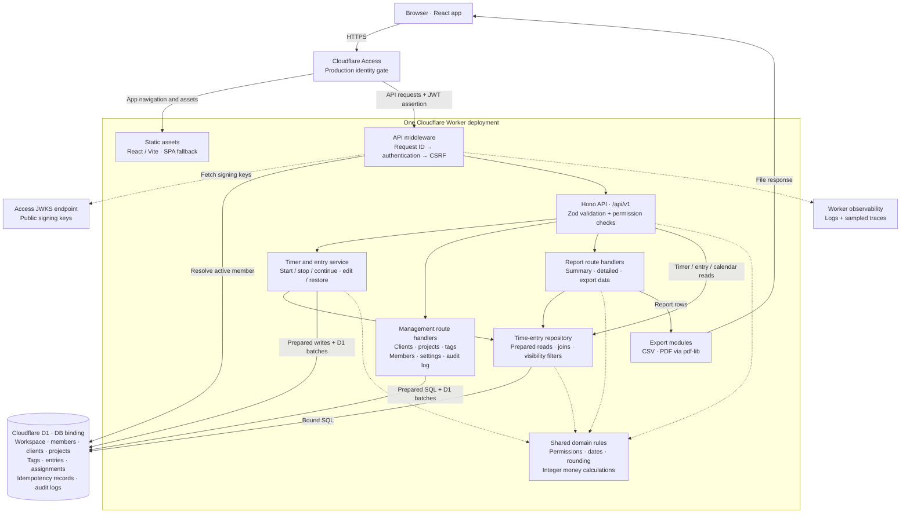

# Backend architecture

This diagram describes the current source and intended production topology. Hourlark packages
the React application and Hono API in one Cloudflare Worker deployment, with one D1 database.
The boxes inside the Worker are code modules, not independently deployed services.

Solid arrows show request, data, or response flow. Dashed arrows show supporting dependencies
and runtime telemetry. Management and report handlers both live in `src/worker/routes/api.ts`.
JSON responses return through the same HTTP request path; only file responses are drawn explicitly.

## Request and security boundaries

- `/api/*` runs the Worker first. Other application paths use static assets and the SPA fallback.
- `/api/v1/*`, including `/health`, runs authentication and CSRF middleware. Authentication verifies
  the Access JWT's signature, issuer, audience, and identity claims using `jose`, then resolves the
  provisioned D1 member and requires active status. Bootstrap administrators are allowlisted.
- Mutations require the same origin and a member-bound, expiring HMAC CSRF token. `/me` supplies
  the token to the frontend. Read requests bypass the CSRF mutation checks.
- Authorization is enforced in route handlers, entry services, and repository visibility filters.
  Member, Manager, and Admin grants come from the shared domain policy. Financial fields are
  omitted for members; financial exports require Manager or Admin permission.
- Development and test can use seeded identities. Runtime configuration rejects development
  authentication in production.

## Persistence and consistency

The repository is a reusable SQL module, not a universal persistence layer: authentication,
management handlers, and the entry service also issue native D1 prepared statements directly.

- `time_entries` stores running and completed timers, soft deletion, optimistic versions, and
  rate/currency snapshots. A partial unique index allows one running timer per member.
- Timer start batches the saved idempotent response, previous timer stop, new entry, tags, and audit
  event. Retried timer requests reuse the D1 response; reusing a key with different input fails.
- `project_members` and `time_entry_tags` hold assignments and tag associations.
- `audit_logs` stores mutation history with actor, before/after state, request ID, and Cloudflare ray
  ID. SQL triggers prevent audit updates and deletion.
- Member updates use a batch and SQL guards to reject stale versions and preserve the last active
  administrator. `member_update_checks` is an internal guard table introduced by migration 0003.
- SQL migrations in `migrations/` are canonical. There is no ORM in the runtime data path.

## Reporting and exports

Report handlers load authorized entries and workspace settings from D1, then apply shared date,
rounding, grouping, and integer money rules in the Worker. Reports reject datasets exceeding
5,000 matching entries. PDF exports additionally reject more than 2,000 detail lines.

CSV and PDF are generated in the request and returned directly. PDFs use `pdf-lib` and embedded
standard fonts. The runtime has no configured queue, Durable Object, KV, R2, separate report
server, or external PDF service.

## Notifications

A cron trigger (`*/5 * * * *`) runs the Worker's `scheduled()` handler, which calls
`runNotificationSweep` in `src/worker/services/notifications.ts`. Each run checks every active
member for two rules, using their stored preferences or the defaults in
`src/domain/notifications/schedule.ts`:

- **Long-running timer**: the running entry passed the member's threshold (8 h by default).
  Deduplicated by entry ID, so each forgotten timer is reported once.
- **Tracking reminder**: from the reminder time (17:00 by default) until local midnight in the
  member's timezone, on enabled weekdays, if they tracked less than their goal that day, running
  time included. Deduplicated by local date, so a missed run catches up the same day only.

Rows go to `notifications` with a unique `(member_id, kind, dedupe_key)`; only rows a run
actually inserts are pushed, so retries and overlapping runs never notify twice. The same run
deletes notifications older than 30 days. The sidebar bell reads the unread count from the
`/timer` response it already polls.

Web Push (`src/worker/services/web-push.ts`) implements RFC 8291 encryption with WebCrypto and
RFC 8292 VAPID with `jose`. It is enabled only when all three `VAPID_*` secrets are set.
Subscriptions are accepted only for the browser push services' hosts, and push services' 404
or 410 answers delete the subscription. `public/sw.js` shows the notification and focuses or
opens `/time` on click. Push text is generic, with no descriptions, projects, or clients.
Subscribing and unsubscribing a device are audited, recording only the push service's origin;
preference changes are not. Signing out turns off the device's push subscription first, and the settings dialog
shows push as on only when the server binds this device to the signed-in member.

Known limitations, accepted for now:

- Delivery is at most once: a push that fails (or a run that stops after inserting) is not
  retried, though the notification stays in the inbox.
- The daily total ignores stopped entries that started more than 24 hours before local midnight.
- A timer still running after 30 days can warn again once its first warning is pruned.
- The bell lists the newest 50 notifications; older unread ones keep the badge lit until the
  30-day prune. Observability logs and traces are separate
  from the durable business audit log in D1.

## Source map

| Component                                        | Source                                                                             |
| ------------------------------------------------ | ---------------------------------------------------------------------------------- |
| Worker entry and middleware order                | [`src/worker/index.ts`](../src/worker/index.ts)                                    |
| Deployment, assets, D1, observability            | [`wrangler.jsonc`](../wrangler.jsonc)                                              |
| Access identity and D1 membership                | [`authentication.ts`](../src/worker/middleware/authentication.ts)                  |
| CSRF tokens and mutation checks                  | [`csrf.ts`](../src/worker/middleware/csrf.ts)                                      |
| API routes, management, and report orchestration | [`api.ts`](../src/worker/routes/api.ts)                                            |
| Timer and entry mutations                        | [`entries.ts`](../src/worker/services/entries.ts)                                  |
| Reusable entry queries and rate resolution       | [`time-entries.ts`](../src/db/repositories/time-entries.ts)                        |
| Shared permission grants                         | [`policy.ts`](../src/domain/permissions/policy.ts)                                 |
| Report calculations                              | [`reporting.ts`](../src/domain/reports/reporting.ts)                               |
| CSV and PDF generation                           | [`csv.ts`](../src/worker/exports/csv.ts), [`pdf.ts`](../src/worker/exports/pdf.ts) |
| Database schema and guards                       | [`migrations/`](../migrations/)                                                    |

This is a source-level architecture diagram, not confirmation of a live deployment. The checked-in
production configuration contains placeholders for D1 and Access that must be supplied at deployment.
